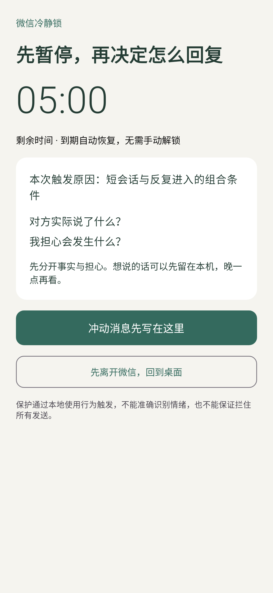

# WeChat Cooldown Lock · 微信冷静锁

An Android app that helps you pause before sending impulsive, hurtful messages on WeChat. It offers mood check-ins, can start a timed cooldown when repeated short visits match your settings, and gives you a private place to write without sending.

一款帮助你在情绪冲突中减少冲动发送伤人消息的 Android 应用。它会在进入微信时进行情绪问候，根据预设的反复短时使用行为启动冷静期，也提供一个可以写下想说的话、但不会发送的本地记录空间。

[Download APK / 下载 APK](https://github.com/shialvin531-del/WeChat-Cooldown-Lock/releases/latest) · [English](#english) · [简体中文](#简体中文)

Android 10+ · Version / 版本 1.0.2 (testing build / 测试版) · App interface: Simplified Chinese / 应用界面：简体中文

## English

### Who is it for?

This is a personal tool for people who want a pause before reacting during relationship conflicts or other stressful conversations. You use it on your own phone; your partner does not need to install anything or participate.

Once you enable protection and grant the required permissions, it monitors app transitions in the background. You do not have to remember to start a cooldown every time you feel upset.

### How it works

1. **A brief check-in when you enter WeChat.** Choose how you feel: good, irritated, angry, or afraid of losing the relationship. Feeling good lets you continue; irritation offers a small cooldown shortcut. Anger and fear offer a cooldown, with a setting to start it immediately. Switching chats or browsing Moments inside WeChat does not repeat the check-in.
2. **Automatic protection based on usage patterns.** Repeated short visits can trigger a cooldown when the conditions below are met. The app looks at app-entry and exit times, not what you type or receive.
3. **A timed cooldown.** A protection page covers WeChat and shows the remaining time and trigger reason. Reopening WeChat keeps the same deadline. The page clears automatically when time runs out. Other apps remain available; there is no in-app button to end a cooldown early.
4. **A place to write without sending.** Save a private note with your mood, time, and trigger reason. Review or delete it later. Notes are never sent to WeChat.

Automatic cooldowns default to **5 minutes**; one-tap manual cooldowns default to **20 minutes**. Available durations are 5, 10, 20, 30, and 60 minutes. Manual shortcuts are available on the home screen, launcher, notification, and Quick Settings tile.

### What triggers an automatic cooldown?

With the default settings, **3 qualifying returns within 5 minutes** start a **5-minute cooldown**. Every counted return must meet all of these conditions:

| Condition | Default rule |
| --- | --- |
| Previous WeChat visit | Less than 60 seconds |
| Where you went first after leaving | The phone's home screen or WeChat Cooldown Lock |
| Time away before returning | At least 10 seconds, within the 5-minute window |

The first opening does not count as a return. For example: first opening → qualifying return 1 → return 2 → return 3 → cooldown.

<details>
<summary>How counting works, including skipped returns</summary>

- Choosing a good mood does not reset the count.
- A return after less than 10 seconds away is skipped; earlier qualifying returns stay in the window.
- Leaving WeChat directly for a browser or another app is excluded, even if you later pass through the home screen. This reduces the chance of counting a return from a WeChat external link.
- A WeChat visit lasting 60 seconds or longer clears the earlier count. Individual returns expire after 5 minutes; restarting the monitoring session also clears its in-memory count.
- Thresholds are adjustable. Optional sensitive hours reduce the reopening threshold by one, to a minimum of two, while keeping the other conditions. Sensitive hours are off by default.

</details>

These are behavior-based rules, not emotion detection. Normal conversations can match the same pattern and trigger a cooldown; some impulsive behavior may not match it. Adjust the thresholds if the default rules interrupt your usual use.

### Download and get started

1. Open [Releases](https://github.com/shialvin531-del/WeChat-Cooldown-Lock/releases/latest), download the `.apk`, and install it on your Android phone.
2. Open the app's protection settings. Grant **Usage access** to detect app transitions and **Display over other apps** to show protection pages in basic mode.
3. Optionally enable **Enhanced protection** in Android Accessibility settings. It uses window-transition metadata and an accessibility overlay; it does not read chat content. Notifications are optional and provide status and a one-tap shortcut.
4. Return to the home screen and confirm that protection is running. Open WeChat to check that the mood page appears.

### Privacy and current limits

The app runs locally without an account, server, or runtime internet connection. It does not read WeChat messages, input fields, passwords, or notifications, and it does not modify WeChat. Notes and settings stay in the app's local storage; uninstalling removes them.

Android and manufacturer battery policies can stop background protection or delay events. Notification replies, split-screen, floating windows, and cloned WeChat apps are not guaranteed to be covered. The app cannot guarantee that every message will be intercepted or that protection will always stay active.

The current APK is a debug-signed testing build. **70 automated tests passed**, but physical-device verification, including Xiaomi 15 / HyperOS, is still pending. The app interface is currently in Simplified Chinese; this project description is bilingual.

## 简体中文

### 这款 App 适合谁？

适合希望在感情冲突或其他压力较大的聊天中，给自己留一点反应时间的人。它只需要安装在你自己的手机上，单人使用，不需要对象参与。

开启保护并授予权限后，App 会在后台监测应用切换，不需要你每次意识到自己生气后，再主动启动冷静锁。

### 它是怎么工作的？

1. **进入微信时，先问候一下情绪。** 选择“心情不错”“有点烦躁”“我很生气”或“害怕失去这段感情”。心情不错时继续聊天；烦躁时保留一个小型冷静入口；生气或害怕失去时提供冷静选项，也可以设置为直接启动冷静期。微信内部切换聊天对象、浏览朋友圈，不会重复问候。
2. **根据使用行为，自动触发保护。** 如果你反复短时间进入微信，并满足下方的组合条件，App 会自动启动冷静期。它检测的是进入和离开微信的时间，不是你正在聊什么。
3. **冷静期间，暂时覆盖微信。** 保护页显示剩余时间和触发原因。反复进入微信不会重新计时，到期自动撤下，不需要手动解锁。你仍可使用其他应用；App 内没有提前结束冷静的按钮。
4. **想发的话，可以先写下来。** 在独立输入框中保存文字、情绪、时间和触发原因，之后可以回看或删除。记录不会发送到微信。

自动触发默认冷静 **5 分钟**，手动一键启动默认 **20 分钟**。可选时长为 5、10、20、30、60 分钟。首页、桌面快捷方式、通知栏和系统快捷设置磁贴都可提供一键冷静入口。

### 什么情况下会自动冷静？

默认设置下，**5 分钟内累计 3 次合格返回微信**，启动 **5 分钟冷静期**。每一次计数都必须同时满足：

| 条件 | 默认规则 |
| --- | --- |
| 上一次使用微信的时长 | 不足 60 秒 |
| 离开微信后先去了哪里 | 手机桌面，或微信冷静锁 App |
| 再次进入前离开了多久 | 至少 10 秒，且仍在 5 分钟窗口内 |

首次打开不算“返回”。例如：首次进入 → 第 1 次合格返回 → 第 2 次 → 第 3 次 → 启动冷静期。

<details>
<summary>展开查看计数细节：哪些情况会跳过或清空？</summary>

- 选择“心情不错”不会清空累计。
- 离开不足 10 秒，只跳过这次返回，不清空窗口内之前的次数。
- 从微信直接打开浏览器等其他应用后再返回，不计入风险，即使中途经过桌面。这是为了减少将微信外链返回误计为反复重开的情况。
- 单次使用微信达到 60 秒，会清空之前的累计。每个已计入的返回超过 5 分钟后过期；监测会话重启也会清空内存中的累计。
- 门槛可以自行调整。可选的敏感时段会将重新打开门槛降低 1 次，最低为 2 次，其余条件仍须满足；敏感时段默认关闭。

</details>

这些规则判断的是行为，不能识别真实情绪。正常聊天如果出现相同行为，也可能触发；有些冲动行为则可能未被触发。如果默认设置经常影响你的正常使用，可以调整门槛。

### 下载与开始使用

1. 打开 [Releases 下载页](https://github.com/shialvin531-del/WeChat-Cooldown-Lock/releases/latest)，下载 `.apk`，在 Android 手机上安装。
2. 进入 App 的“保护设置”。授予**使用情况访问**，用于检测应用切换；授予**显示在其他应用上层**，用于基础模式显示保护页。
3. 可选开启系统无障碍设置中的**增强保护**，通过窗口切换信息补充检测，并显示无障碍覆盖页，不读取聊天内容。通知权限为可选，用于显示状态和一键冷静入口。
4. 返回首页，确认保护正在运行，再打开微信检查情绪问候是否出现。

### 隐私与目前的限制

App 在本地运行，不需要账号、服务器或运行时联网。不读取微信消息、输入框、密码或通知，不修改微信。文字记录和设置保存在应用本地存储中，卸载会清除数据。

Android 系统和厂商电池策略可能停止后台保护或延迟事件。通知快捷回复、分屏、小窗、微信分身等路径无法保证覆盖，也不能保证拦住所有消息或始终保持运行。

当前 APK 为调试签名测试版，**70 项自动化测试已通过**；包括小米 15 / HyperOS 在内的真机验证仍待完成。目前应用界面为简体中文，本项目介绍提供中英双语。

详细操作、权限与自检步骤见[中文使用说明](docs/USER_GUIDE.md)。

## Screenshots / 界面预览

<p>
  
  
</p>

These show the actual Compose layouts rendered in an automated test environment, not physical-device WeChat integration screenshots.

以上为自动化测试环境绘制的实际 Compose 页面，用于展示布局，并非微信联动真机截图。

<details>
<summary>For developers / 开发者：技术架构、构建与验证</summary>

Kotlin · Jetpack Compose · MVVM · DataStore · Room. Minimum SDK 29, target SDK 36. Gradle 9.1.0, AGP 9.0.1, Kotlin 2.2.10; built with JDK 25.

| Module / 模块 | Responsibility / 职责 |
| --- | --- |
| `core` | Behavior rules, settings validation, cooldown deadlines / 行为规则、设置校验、冷静截止时间 |
| `data` | Local settings, notes, and history / 本地设置、文字记录与历史 |
| `app` | Compose UI, ViewModel, monitoring, overlays, shortcuts / 界面、状态管理、监测、覆盖页与快捷入口 |

Open this directory in Android Studio with Android SDK 36 and Build Tools 36.0.0 installed. / 使用 Android Studio 打开本目录，并安装 Android SDK 36 与 Build Tools 36.0.0。

```sh
bash ./gradlew :app:assembleDebug :core:test :data:testDebugUnitTest :app:testDebugUnitTest :app:lintDebug
```

APK output / 安装包输出：`app/build/outputs/apk/debug/app-debug.apk`.

For Windows paths containing Chinese characters, the helper builds from a temporary ASCII path and exports the APK and reports to `outputs/`. / Windows 中文路径可使用以下脚本，它会在临时 ASCII 路径构建，并将 APK 与报告复制到 `outputs/`。

```powershell
.\build.ps1 -SdkPath 'C:\Android\Sdk' -JavaHome 'C:\path\to\jdk'
```

The script also accepts `-GradleExecutable`; use `-Offline` only when dependencies are already cached. Building may require network access; running the app does not. / 脚本支持 `-GradleExecutable`；依赖已缓存时可加 `-Offline`。构建时可能需要下载依赖，应用运行不需要联网。

See [TESTING.md](TESTING.md) for results and unverified areas. Formal distribution needs your own signing configuration. / 测试结果与未验证范围见 [TESTING.md](TESTING.md)，正式发行需配置自己的签名。

</details>
