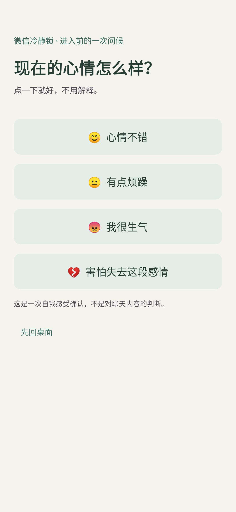

# WeChat Cooldown Lock · 微信冷静锁

在冲动发送消息前，给自己一点冷静时间。

本地运行的 Android 应用：进入微信时进行简短的情绪问候，根据预设的短会话与反复返回行为启动冷静期，并提供不会发送的文字记录空间。

**Android 10+ · Kotlin · Jetpack Compose · MVVM · DataStore · Room · 离线运行**

> 当前版本：1.0.2，调试签名测试版。行为规则不能识别真实情绪；正常聊天出现相同行为也可能触发。尚未完成小米 15 / HyperOS 真机验证。

## 下载

[下载最新 APK / Download APK](https://github.com/shialvin531-del/WeChat-Cooldown-Lock/releases/latest)

在 Releases 页面下载 `.apk` 并在 Android 手机上安装。源码可通过本页的 **Code → Download ZIP** 获取。

## 功能

- 从其他应用进入微信时问候一次，微信内部切换聊天和朋友圈不重复问候。
- 组合行为触发：时间窗口、重新进入次数、前一次会话时长、离开时长同时判断。
- 支持 5、10、20、30、60 分钟冷静期；重进微信不重新计时，到期自动结束。
- 首页、桌面快捷方式、通知、系统快捷设置磁贴提供冷静入口。
- 可选敏感时间段，支持跨午夜。
- 本地保存情绪、想发的话和冷静历史，支持删除。
- 可选增强保护，监听窗口切换元数据，补充 UsageStats 检测。

## 界面

以下是自动化环境绘制的实际 Compose 页面，用于展示布局，并非微信联动真机截图。

<p>
  
  
</p>

## 自动触发如何计数

默认在 **5 分钟内累计 3 次合格重新进入**，自动启动 **5 分钟**冷静期。首次打开不算重新进入。

一次重新进入需要同时满足：

1. 前一次微信会话不足 60 秒。
2. 离开微信时先回桌面或进入微信冷静锁 App。
3. 离开至少 10 秒，并在窗口内返回微信。

选择“心情不错”不清空累计。某次离开太短或先打开其他应用，只跳过本次；主页仍显示累计次数和最近一次判断原因。聊天达到会话上限会清空此前累计，超过窗口的次数自动过期。

直接打开浏览器等其他应用后的返回采取保守排除，即使中途经过桌面，以免将微信外链返回计入风险。这也可能漏掉真实冲动行为。规则不分析聊天内容，不能保证没有误触发或漏触发。

阈值可以调整。敏感时段默认关闭，开启后将重新进入门槛降低 1 次，最低为 2 次，仍须满足其余条件。

## 安装与权限

构建产物为 `outputs/WeChat-Cooldown-Lock-1.0.2-debug.apk`。`outputs/` 不纳入 Git，克隆源码后需自行构建。同一签名的旧版可覆盖安装。

首次打开应用，在保护设置中阅读用途并主动授权，再返回首页确认保护正在运行。

| 权限 / 系统功能 | 用途 |
| --- | --- |
| 使用情况访问 | 获取应用进入、离开的包名与时间事件 |
| 显示在其他应用上层 | 基础模式显示问候和冷静覆盖页 |
| 通知（Android 13+，可选） | 常驻监测状态与一键冷静操作 |
| 无障碍增强保护（可选） | 接收窗口状态切换，使用无障碍覆盖页 |
| 前台服务、开机广播 | 运行用户开启的监测，尝试在重启后恢复 |

增强服务声明 `canRetrieveWindowContent=false`、`canPerformGestures=false`，不读取聊天、输入框、密码或通知，不截图，不执行手势。不修改微信 APK、不注入微信进程。

没有账号、服务器或网络接口，APK 无 INTERNET 权限。数据存于应用私有目录，禁用云备份与设备迁移；卸载会清除数据。详见[使用与权限说明](docs/USER_GUIDE.md)。

## 构建

用 Android Studio 打开本目录，配置 Android SDK 36 / Build Tools 36.0.0。项目使用 Gradle 9.1.0、AGP 9.0.1 和 Kotlin 2.2.10，已在 JDK 25 环境构建。

```sh
bash ./gradlew :app:assembleDebug :core:test :data:testDebugUnitTest :app:testDebugUnitTest :app:lintDebug
```

常规 Gradle APK 路径：`app/build/outputs/apk/debug/app-debug.apk`。

Windows 中文路径可使用脚本，它会复制源码到临时 ASCII 路径构建，并将通过检查的安装包和报告复制到 `outputs/`：

```powershell
.\build.ps1 -SdkPath 'C:\Android\Sdk' -JavaHome 'C:\path\to\jdk'
```

脚本也接受 `-GradleExecutable` 指定已安装的 Gradle，依赖齐全时可加 `-Offline`。首次构建需要下载依赖，应用运行不需要网络。正式发行需配置自己的签名。

## 项目结构与验证

| 模块 | 职责 |
| --- | --- |
| `core` | 纯 Kotlin 行为规则、设置校验、单调时钟截止时间 |
| `data` | DataStore、Room、本地记录、冷静状态与持久化 |
| `app` | Compose 页面、ViewModel、UsageStats、增强服务、覆盖页和快捷入口 |

自动化验证覆盖规则、外链排除、正常长聊、快速切换、计数保留、Room/DataStore、覆盖页生命周期、服务重连和自动到期。结果及未验证范围见 [TESTING.md](TESTING.md)。

## 使用边界

本应用提供自愿开启的临时保护。应用内不提供提前结束冷静的按钮，仍可返回桌面使用其他应用。

Android 或厂商后台策略可能停止进程、延迟事件或撤销权限。通知快捷回复、分屏、小窗、微信分身等入口尚不能保证覆盖；不能保证拦住所有发送，也不能保证永远运行或无法绕过。

遇到问题时，请提供应用版本、手机型号、系统版本、是否启用增强保护，以及首页累计次数和最近一次判断原因。无需提供聊天内容。
